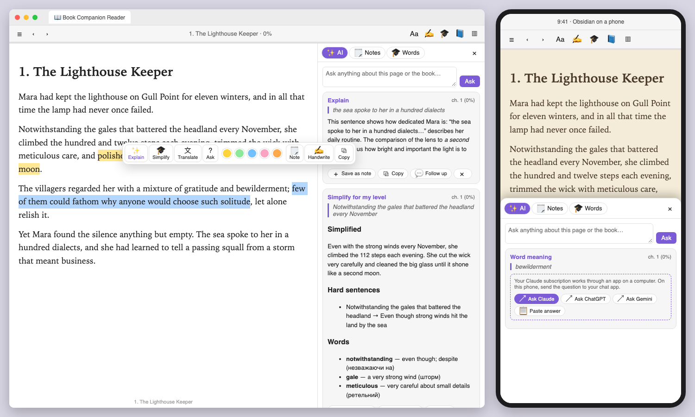

<p align="center">
  
</p>

<h1 align="center">Book Companion Reader</h1>

<p align="center">
  <strong>Read PDFs and EPUBs in Obsidian, on desktop and mobile.</strong><br>
  Select any text to have AI explain it or simplify it for your language level. Your highlights, notes, vocabulary and handwriting stay linked to each book.
</p>

<p align="center">
  <a href="https://volland.github.io/book-companion-reader/"><b>Website</b></a> ·
  <a href="obsidian://show-plugin?id=book-companion-reader">Install in Obsidian</a> ·
  <a href="https://github.com/Volland/book-companion-reader/releases/latest">Download</a> ·
  <a href="https://typedgraph.org/">Pairs with Typed Graph</a>
</p>

<p align="center">
  
  
  
</p>



## Why

E-readers let you tap a word to see what it means. This plugin brings that into Obsidian and goes further. It explains whole passages in context, rewrites hard sentences at **your** language level, and turns what you read into notes connected to the book, so every book grows a small knowledge system in your vault.

## Features

### 📖 One reader for PDF and EPUB
- **EPUB**: page turning like an e-reader (tap the edges, swipe or use the arrow keys) or scrolling. Choose text size, a serif, sans or theme font, and like-Obsidian, sepia, light or dark paper. Images and in-book links work.
- **PDF**: crisp pages from Obsidian's own PDF engine, real text selection, zoom, the outline (table of contents) and *Go to page*. Dark paper darkens PDFs too.
- Your place is remembered per book, and reading progress shows in the toolbar and the library.
- **Library** (📚 ribbon icon): every PDF and EPUB in the vault on one shelf, with generated covers, progress, highlight and word counts, and search.

### ✨ AI on whatever you select
A toolbar appears over any selection:

| Button | What you get |
|---|---|
| **Explain** | what the passage means in its context: references, idioms, why it matters |
| **Simplify** | the passage rewritten for your level, hard sentences paired with easier versions, and a word list |
| **Word** | for one to four words: meaning in this sentence, part of speech, translation, an example and easier synonyms |
| **Translate** | into your native language, with a note on phrases that don't translate literally |
| **Ask** | your own question, with the passage and its surroundings as context |

You can also **Study this page** (summary, hard sentences and up to 12 words from what's on screen), ask anything about the book in the panel, and ask follow-up questions in the same thread. Answers render as Markdown and can be saved as notes with one tap.

### 🎓 Language learning
- Set your **native language**, the **language you're learning** and your **level** (A1 to C2, or native).
- **More than one language?** Add each with its own level, for example *English C1* and *German B1*. A book's language is read from the EPUB, or you pick it in the reader's panel, and every explanation, simplification and word list then uses that language's level.
- Explanations come in simple words of the language you're learning (more practice) or in your native language. You choose.

### 🃏 Flashcards and decks
- **Card** (on any selected word) makes a flashcard in one tap: the word in its dictionary form (with the article for German nouns), the translation, a short meaning at your level, an example, and **the sentence from the book** with the word marked. The card links back to the exact page.
- Words from **Simplify** and **Study this page** can be saved as cards too.
- **Decks**: every book gets its own deck, and you can make **topic decks** (*Sailing words*, *Legal German*…) and move cards between them. Choose where new cards go from the Words tab.
- **Practise** with a built-in spaced-repetition trainer: see the word in its sentence, show the answer, then *Again*, *Good* or *Easy*. Cards come back after 1, 3, 7, 14 and 30 days. Keys: <kbd>Space</kbd> to reveal, <kbd>1</kbd> <kbd>2</kbd> <kbd>3</kbd> to answer. Works the same on phones.
- The **Flashcards** view (ribbon icon 🗂) lists decks with how many cards are due, lets you browse, edit, search and delete cards, and add your own.
- Book decks also keep a flashcard note (`word :: meaning`, tagged `#flashcards`) in the book's folder, and any deck can be **saved as a note** for the Spaced Repetition plugin.

### 🗂️ A small system around every book
Each book gets a folder (default `Books/<Title>/`) containing:
- a **book page** with title, author, status, progress, start and last-read dates, and sections for *Highlights, Notes, Handwriting, Vocabulary, AI explanations*
- `Notes/`: one note per thought, with the quote and a link back to the exact spot
- `Handwriting/`: your handwritten pages as SVG
- `Vocabulary – <Title>.md`: your flashcards

Every entry links back into the book through `obsidian://book-reader?file=…&loc=p12`, and opening the link jumps to that page.

### ✍️ Handwriting
- **Write on PDF pages** with a pen, highlighter and eraser, five colours, and undo/redo. Strokes stay on their page.
- **Handwritten notes** on lined, dotted or blank paper, about the page or a selection. Saved as SVG and embedded in a note. *Edit handwriting* from the file menu reopens them for more writing.
- Pen pressure for Apple Pencil, S Pen and other styluses. With **pen only** on, the stylus draws and your finger scrolls, so a resting palm makes no marks.

### 📱 Same on phone and desktop
Built for Obsidian mobile from the start: big touch targets, swipe page turns, and the companion panel as a bottom sheet. Nothing needs a desktop except the optional subscription apps described below.

## AI: use what you already have

Pick it in **Settings → Book Companion Reader → AI service**.

| Option | Where | What you need |
|---|---|---|
| **My Claude subscription** (default) | computer | [Claude Code](https://claude.com/claude-code) installed; run `claude` once to sign in with your Claude Pro/Max account |
| **My ChatGPT subscription** | computer | [Codex CLI](https://github.com/openai/codex); run `codex` once to sign in with ChatGPT Plus/Pro |
| **My Google account (Gemini)** | computer | [Gemini CLI](https://github.com/google-gemini/gemini-cli), signed in (whether it works depends on your Google plan) |
| **My chat app** | any device | nothing: the question opens in the Claude, ChatGPT or Gemini app, and you paste the answer back |
| Anthropic / OpenAI / OpenRouter | any device | an API key |
| Ollama / OpenAI-compatible | computer or your network | a running local server |

On a phone, the subscription options switch to **chat-app hand-off** automatically: tap *Ask Claude*, *Ask ChatGPT* or *Ask Gemini*, then *Paste answer*.

## 🔗 Install it together with Typed Graph (recommended)

[**Typed Graph**](https://github.com/Volland/typedgraph) turns your notes into a typed property graph that you can query with openCypher and explore in a graph view. The two plugins are designed to work as a pair:

- With Typed Graph enabled, *Typed notes* switches on by itself (Settings → Typed Graph → *When Typed Graph is on*).
- The **book page** becomes a `Book` from Typed Graph's library ontology (status, format and dates as properties), with `written_by:: [[Author]] {role: "author"}`.
- Notes from a selection become `ReadingNote` + `Quote`, with `note_on:: [[Book]] {loc: "p12"}`, `quoted_from:: [[Book]]` and the page number.
- Saved AI answers become `Explanation` with `explains:: [[Book]] {loc, action}`. Handwritten notes become `Handwriting`, and word lists become `Vocabulary` with `vocabulary_of`.
- The schema notes are added for you: `Types/Book Companion.md`, plus Typed Graph's `Library.md` if your vault has no `Book` type yet (it is never declared twice).
- **Show in graph** (Notes tab or command) opens the book page in Typed Graph's graph view.

For example:

````markdown
```graph-query
MATCH (n)-[r:note_on|explains]->(b:Book)
RETURN b.title AS book, count(n) AS notes
ORDER BY notes DESC
```
````

````markdown
```graph-query
MATCH (q:Quote)-[:quoted_from]->(b:Book)-[:written_by]->(a:Author)
RETURN a.title AS author, b.title AS book, q.title AS quote, q.page AS page
```
````

These notes are checked against Typed Graph's own engine: the test vault reads back as Books, Quotes, ReadingNotes, Explanations, Handwriting and Vocabulary with every edge in place.

## Install

1. **Community plugins**: Settings → Community plugins → Browse, search for *Book Companion Reader*, then install and enable it. Or [open it in Obsidian](obsidian://show-plugin?id=book-companion-reader).
2. **Also install [Typed Graph](obsidian://show-plugin?id=typed-graph)** for typed, queryable reading notes.
3. **BRAT** (beta builds): *Add a beta plugin* → `Volland/book-companion-reader`.
4. **Manually**: copy `main.js`, `manifest.json` and `styles.css` from the [latest release](https://github.com/Volland/book-companion-reader/releases/latest) to `<vault>/.obsidian/plugins/book-companion-reader/`, then reload Obsidian. From a clone: `npm install && npm run build && cargo run -- --install "/path/to/vault"`.

## Use

- Open any `.epub`. For PDFs, use the file menu → **Open in Book Reader**, or turn on *Open PDFs in this reader*.
- Select text and pick an action from the toolbar. Tap a highlight to explain it, add a note, recolour or remove it.
- Toolbar: contents · previous/next · position · text and layout (EPUB) or zoom and ✏️ write on the page (PDF) · handwritten note · study this page · book page · companion panel.
- Commands (assign your own hotkeys): explain, simplify or define the selection, make a flashcard, open flashcard decks, study flashcards that are due, highlight, new note, handwritten note, write on page, study this page, toggle panel, book page, show in Typed Graph, add book types to Typed Graph schema, next/previous page, contents, open library.

## Disclosures

- **Network**: text is sent only when you press an AI button, and only to the service you chose in settings: the selection, a little surrounding text, and your language and level settings. With the subscription options, it goes through that app on your computer. With *My chat app*, it opens in that app's website or app.
- **Accounts and payments**: the plugin is free. AI features need an account with an AI service you choose (or a local model), and that service's own terms and prices apply.
- **Local programs (desktop only)**: the subscription options start the Claude Code, Codex or Gemini command line on your computer to ask your question. Nothing else is run.
- **Your files**: the plugin writes only inside its books folder (default `Books/`) and, with typed notes on, two schema notes in your Typed Graph schema folder. Reading positions, highlights and page handwriting are kept in the plugin's own data. API keys are stored in plain text in the plugin's settings in your vault.
- **Internal API**: *Open PDFs in this reader* uses an unofficial part of Obsidian to replace the built-in PDF viewer. It is off by default.

## Development

```text
src/            the plugin (TypeScript): reader view, PDF and EPUB renderers, AI client, notes, handwriting, Typed Graph schema
src/main.rs     a small launcher: preview, --screenshot, --self-test, --install <vault>
test/           a stand-in Obsidian API, a sample book and the self-test
preview/        the real reader running in a browser with the sample book (EPUB and PDF)
website/        the landing page (GitHub Pages)
```

```bash
npm install
npm run build                 # plugin + preview + self-test bundles
npm run selftest              # drives the reader through its core flows
cargo run                     # opens the preview in your browser
cargo run -- --install <vault>
npm run version:bump -- 0.2.0 # then commit and push a tag named 0.2.0 → the release workflow publishes it
```

## License

[MIT](LICENSE) © Volodymyr Pavlyshyn. Not affiliated with Obsidian, Anthropic, OpenAI or Google.
